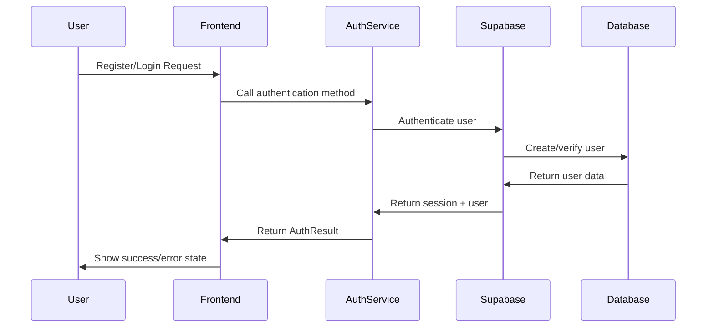

# Authentication API Documentation

This document provides comprehensive API documentation for the authentication system in the AI Prompt Directory application.

## Table of Contents

1. [Overview](#overview)
2. [Authentication Flow](#authentication-flow)
3. [API Endpoints](#api-endpoints)
4. [Service Classes](#service-classes)
5. [Error Handling](#error-handling)
6. [Request/Response Examples](#requestresponse-examples)
7. [Integration Guide](#integration-guide)
8. [Security Considerations](#security-considerations)

## Overview

The authentication system provides:
- User registration and login
- Social authentication (Google, GitHub, Discord, Twitter)
- Profile management
- Favorites functionality
- Feature flag-based enablement
- Comprehensive error handling

### Technology Stack
- **Backend**: Supabase Auth with PostgreSQL
- **Frontend**: Astro with TypeScript
- **Authentication Flow**: PKCE (Proof Key for Code Exchange)
- **Session Management**: JWT tokens with automatic refresh

## Authentication Flow



## API Endpoints

### Authentication Endpoints

#### `POST /api/auth/register`
Register a new user with email and password.

**Request Body:**
```typescript
{
  email: string;
  password: string;
  fullName?: string;
}
```

**Response:**
```typescript
{
  success: boolean;
  user?: User;
  session?: Session;
  error?: string;
}
```

**Example:**
```javascript
const response = await fetch('/api/auth/register', {
  method: 'POST',
  headers: { 'Content-Type': 'application/json' },
  body: JSON.stringify({
    email: 'user@example.com',
    password: 'securePassword123',
    fullName: 'John Doe'
  })
});
```

#### `POST /api/auth/login`
Authenticate user with email and password.

**Request Body:**
```typescript
{
  email: string;
  password: string;
}
```

**Response:**
```typescript
{
  success: boolean;
  user?: User;
  session?: Session;
  error?: string;
}
```

#### `POST /api/auth/logout`
Sign out the current user.

**Request:** No body required

**Response:**
```typescript
{
  success: boolean;
  error?: string;
}
```

#### `POST /api/auth/social-login`
Initiate social authentication flow.

**Request Body:**
```typescript
{
  provider: 'google' | 'github' | 'discord' | 'twitter';
  redirectTo?: string;
}
```

**Response:**
```typescript
{
  success: boolean;
  url?: string; // OAuth authorization URL
  error?: string;
}
```

#### `GET /api/auth/callback`
Handle OAuth callback and complete authentication.

**Query Parameters:**
- `code`: Authorization code from provider
- `state`: CSRF protection state

**Response:** Redirects to appropriate page with session

### Favorites Endpoints

#### `POST /api/favorites/toggle`
Toggle favorite status for content.

**Request Body:**
```typescript
{
  contentType: 'prompt' | 'persona' | 'blog';
  contentSlug: string;
  contentTitle?: string;
}
```

**Response:**
```typescript
{
  success: boolean;
  isFavorited: boolean;
  error?: string;
}
```

#### `GET /api/favorites/list`
Get user's favorites with pagination.

**Query Parameters:**
- `contentType?`: Filter by content type
- `page?`: Page number (default: 1)
- `limit?`: Items per page (default: 20)

**Response:**
```typescript
{
  items: FavoriteItem[];
  total: number;
  hasMore: boolean;
}
```

## Service Classes

### AuthService

The main authentication service providing all auth operations.

#### Static Methods

##### `isEnabled(): boolean`
Check if authentication is enabled in the application.

```typescript
if (AuthService.isEnabled()) {
  // Show auth features
}
```

##### `register(credentials: RegisterCredentials): Promise<AuthResult>`
Register a new user.

```typescript
const result = await AuthService.register({
  email: 'user@example.com',
  password: 'password123',
  fullName: 'John Doe'
});

if (result.success) {
  console.log('User registered:', result.user);
} else {
  console.error('Registration failed:', result.error);
}
```

##### `login(credentials: LoginCredentials): Promise<AuthResult>`
Sign in with email and password.

```typescript
const result = await AuthService.login({
  email: 'user@example.com',
  password: 'password123'
});
```

##### `loginWithProvider(provider: SocialProvider, redirectTo?: string): Promise<AuthResult>`
Initiate social authentication.

```typescript
const result = await AuthService.loginWithProvider('google');
if (result.success) {
  // User will be redirected to Google OAuth
}
```

##### `logout(): Promise<AuthResult>`
Sign out the current user.

```typescript
const result = await AuthService.logout();
```

##### `getSession(): Promise<Session | null>`
Get the current user session.

```typescript
const session = await AuthService.getSession();
if (session) {
  console.log('User is authenticated');
}
```

##### `getCurrentUser(): Promise<User | null>`
Get the current authenticated user.

```typescript
const user = await AuthService.getCurrentUser();
if (user) {
  console.log('Current user:', user.email);
}
```

##### `getUserProfile(userId?: string): Promise<UserProfile | null>`
Get user profile data.

```typescript
// Get current user's profile
const profile = await AuthService.getUserProfile();

// Get specific user's profile
const profile = await AuthService.getUserProfile('user-id');
```

##### `updateProfile(updates: Partial<UserProfile>): Promise<AuthResult>`
Update user profile.

```typescript
const result = await AuthService.updateProfile({
  full_name: 'Jane Doe',
  bio: 'AI enthusiast and prompt engineer'
});
```

##### `resetPassword(email: string): Promise<AuthResult>`
Send password reset email.

```typescript
const result = await AuthService.resetPassword('user@example.com');
```

##### `updatePassword(newPassword: string): Promise<AuthResult>`
Update user password.

```typescript
const result = await AuthService.updatePassword('newSecurePassword');
```

##### `onAuthStateChange(callback: Function)`
Listen to authentication state changes.

```typescript
const { data: { subscription } } = AuthService.onAuthStateChange((event, session) => {
  if (event === 'SIGNED_IN') {
    console.log('User signed in:', session.user);
  } else if (event === 'SIGNED_OUT') {
    console.log('User signed out');
  }
});

// Cleanup
subscription.unsubscribe();
```

### FavoritesService

Service for managing user favorites.

#### Static Methods

##### `isEnabled(): boolean`
Check if favorites functionality is enabled.

##### `addToFavorites(contentType, contentSlug, contentTitle?): Promise<FavoritesResult>`
Add content to user's favorites.

```typescript
const result = await FavoritesService.addToFavorites(
  'prompt',
  'debug-javascript-error',
  'Debug JavaScript Error'
);
```

##### `removeFromFavorites(contentType, contentSlug): Promise<FavoritesResult>`
Remove content from favorites.

```typescript
const result = await FavoritesService.removeFromFavorites(
  'prompt',
  'debug-javascript-error'
);
```

##### `isFavorited(contentType, contentSlug): Promise<boolean>`
Check if content is favorited.

```typescript
const isFav = await FavoritesService.isFavorited('prompt', 'debug-javascript-error');
```

##### `toggleFavorite(contentType, contentSlug, contentTitle?): Promise<FavoritesResult & { isFavorited: boolean }>`
Toggle favorite status.

```typescript
const result = await FavoritesService.toggleFavorite(
  'prompt',
  'debug-javascript-error',
  'Debug JavaScript Error'
);
console.log('Now favorited:', result.isFavorited);
```

##### `getUserFavorites(contentType?, page?, limit?): Promise<PaginatedFavorites>`
Get user's favorites with pagination.

```typescript
// Get all favorites
const favorites = await FavoritesService.getUserFavorites();

// Get only prompts, page 2, 10 items per page
const prompts = await FavoritesService.getUserFavorites('prompt', 2, 10);
```

##### `getFavoritesCount(contentType?): Promise<number>`
Get count of user's favorites.

```typescript
const totalCount = await FavoritesService.getFavoritesCount();
const promptCount = await FavoritesService.getFavoritesCount('prompt');
```

##### `getBulkFavoriteStatus(items): Promise<Record<string, boolean>>`
Get favorite status for multiple items efficiently.

```typescript
const items = [
  { contentType: 'prompt', contentSlug: 'prompt-1' },
  { contentType: 'persona', contentSlug: 'persona-1' }
];

const statuses = await FavoritesService.getBulkFavoriteStatus(items);
// Returns: { 'prompt:prompt-1': true, 'persona:persona-1': false }
```

##### `exportFavorites(): Promise<FavoritesResult>`
Export user's favorites as JSON.

```typescript
const result = await FavoritesService.exportFavorites();
if (result.success) {
  console.log('Export data:', result.data);
  // Contains: exportDate, userEmail, favorites[], totalCount
}
```

## Error Handling

### Error Types

All authentication operations return consistent error responses:

```typescript
interface AuthResult {
  success: boolean;
  user?: User | null;
  session?: Session | null;
  error?: string;
}

interface FavoritesResult {
  success: boolean;
  data?: any;
  error?: string;
}
```

### Common Error Messages

| Error | Cause | Solution |
|-------|-------|----------|
| "Authentication is disabled" | `ENABLE_USER_AUTH` is not `'true'` | Set environment variable |
| "Invalid credentials" | Wrong email/password | Check credentials |
| "User already registered" | Email already exists | Use different email or login |
| "User must be authenticated" | No active session | Login first |
| "Email already registered" | Duplicate registration attempt | Use login instead |
| "Password too weak" | Password doesn't meet requirements | Use stronger password |
| "Invalid email address" | Malformed email | Check email format |
| "Too many requests" | Rate limiting triggered | Wait before retrying |
| "Database error" | Server-side issue | Check server logs |

### Error Handling Best Practices

```typescript
// Always check for success
const result = await AuthService.login(credentials);
if (!result.success) {
  // Handle specific errors
  switch (result.error) {
    case 'Invalid credentials':
      showError('Please check your email and password');
      break;
    case 'Too many requests':
      showError('Please wait a moment before trying again');
      break;
    default:
      showError('Login failed. Please try again.');
  }
  return;
}

// Success case
console.log('Logged in:', result.user);
```

## Request/Response Examples

### User Registration Flow

**1. Registration Request:**
```javascript
const response = await fetch('/api/auth/register', {
  method: 'POST',
  headers: {
    'Content-Type': 'application/json'
  },
  body: JSON.stringify({
    email: 'jane@example.com',
    password: 'securePassword123',
    fullName: 'Jane Smith'
  })
});

const result = await response.json();
```

**2. Success Response:**
```json
{
  "success": true,
  "user": {
    "id": "550e8400-e29b-41d4-a716-446655440000",
    "email": "jane@example.com",
    "user_metadata": {
      "full_name": "Jane Smith"
    },
    "created_at": "2025-01-15T10:30:00Z"
  },
  "session": {
    "access_token": "eyJhbGciOiJIUzI1NiIsInR5cCI6IkpXVCJ9...",
    "refresh_token": "v1.M...",
    "expires_in": 3600,
    "token_type": "bearer"
  }
}
```

**3. Error Response:**
```json
{
  "success": false,
  "error": "Email already registered"
}
```

### Social Login Flow

**1. Initiate Social Login:**
```javascript
const result = await AuthService.loginWithProvider('google', 'https://mysite.com/dashboard');
if (result.success) {
  // Browser will redirect to Google OAuth
  window.location.href = result.url;
}
```

**2. Handle Callback:**
```javascript
// This happens automatically when user returns from OAuth provider
// The callback endpoint processes the auth code and creates session
```

### Favorites Management

**1. Add to Favorites:**
```javascript
const result = await FavoritesService.addToFavorites(
  'prompt',
  'optimize-web-performance',
  'Optimize Web Performance'
);

if (result.success) {
  console.log('Added to favorites!');
}
```

**2. Get User Favorites:**
```javascript
const favorites = await FavoritesService.getUserFavorites('prompt', 1, 10);
console.log('Favorites:', favorites.items);
console.log('Has more:', favorites.hasMore);
```

### Profile Management

**1. Get Profile:**
```javascript
const profile = await AuthService.getUserProfile();
if (profile) {
  console.log('Profile:', profile);
}
```

**2. Update Profile:**
```javascript
const result = await AuthService.updateProfile({
  display_name: 'Jane',
  bio: 'AI prompt engineer and developer',
  website: 'https://janesmith.dev'
});

if (result.success) {
  console.log('Profile updated!');
}
```

## Integration Guide

### Frontend Integration

#### 1. Authentication State Management

```typescript
// Check authentication state on app load
let currentUser: User | null = null;
let isLoading = true;

async function initAuth() {
  if (!AuthService.isEnabled()) {
    isLoading = false;
    return;
  }

  try {
    currentUser = await AuthService.getCurrentUser();
  } catch (error) {
    console.error('Auth init error:', error);
  } finally {
    isLoading = false;
  }
}

// Listen for auth changes
const { data: { subscription } } = AuthService.onAuthStateChange((event, session) => {
  if (event === 'SIGNED_IN') {
    currentUser = session?.user || null;
  } else if (event === 'SIGNED_OUT') {
    currentUser = null;
  }
});
```

#### 2. Protected Routes

```typescript
// Middleware or route guard
async function requireAuth() {
  if (!AuthService.isEnabled()) {
    return; // Auth disabled, allow access
  }

  const user = await AuthService.getCurrentUser();
  if (!user) {
    // Redirect to login
    window.location.href = '/auth/login';
    return;
  }
}
```

#### 3. Component Integration

```typescript
// Example Astro component
---
import { AuthService } from '@lib/auth-service';

const user = await AuthService.getCurrentUser();
const isAuthenticated = !!user;
---

{isAuthenticated ? (
  <div>Welcome, {user.email}!</div>
) : (
  <a href="/auth/login">Sign In</a>
)}
```

### Backend Integration

#### 1. API Route Protection

```typescript
// Example API route with auth check
export async function POST({ request }) {
  const session = await AuthService.getSession();
  if (!session) {
    return new Response(
      JSON.stringify({ error: 'Unauthorized' }),
      { status: 401, headers: { 'Content-Type': 'application/json' } }
    );
  }

  // Process authenticated request
  const user = session.user;
  // ...
}
```

#### 2. Database Operations

```typescript
// Example: Get user-specific data
async function getUserData(userId: string) {
  const { data, error } = await supabase
    .from('user_data')
    .select('*')
    .eq('user_id', userId);

  if (error) throw error;
  return data;
}
```

## Security Considerations

### Authentication Security

1. **Password Requirements**: Enforce minimum 8 characters with complexity
2. **Rate Limiting**: Implement login attempt limits
3. **Session Security**: Use secure, httpOnly cookies for session tokens
4. **CSRF Protection**: Implement CSRF tokens for state-changing operations
5. **Input Validation**: Validate and sanitize all user inputs

### API Security

1. **Authorization**: Always verify user permissions
2. **Input Sanitization**: Clean all inputs before database operations
3. **SQL Injection Prevention**: Use parameterized queries
4. **Error Information**: Don't expose sensitive data in error messages
5. **Audit Logging**: Log all authentication events

### Example Security Implementation

```typescript
// Input validation
function validateEmail(email: string): boolean {
  const emailRegex = /^[^\s@]+@[^\s@]+\.[^\s@]+$/;
  return emailRegex.test(email);
}

function validatePassword(password: string): boolean {
  return password.length >= 8 && /^(?=.*[a-z])(?=.*[A-Z])(?=.*\d)/.test(password);
}

// Rate limiting (pseudo-code)
const loginAttempts = new Map();

async function checkRateLimit(email: string): Promise<boolean> {
  const attempts = loginAttempts.get(email) || 0;
  if (attempts >= 5) {
    throw new Error('Too many login attempts. Please try again later.');
  }
  return true;
}
```

---

**API Version**: 1.0.0  
**Last Updated**: January 2025  
**Authentication Provider**: Supabase Auth